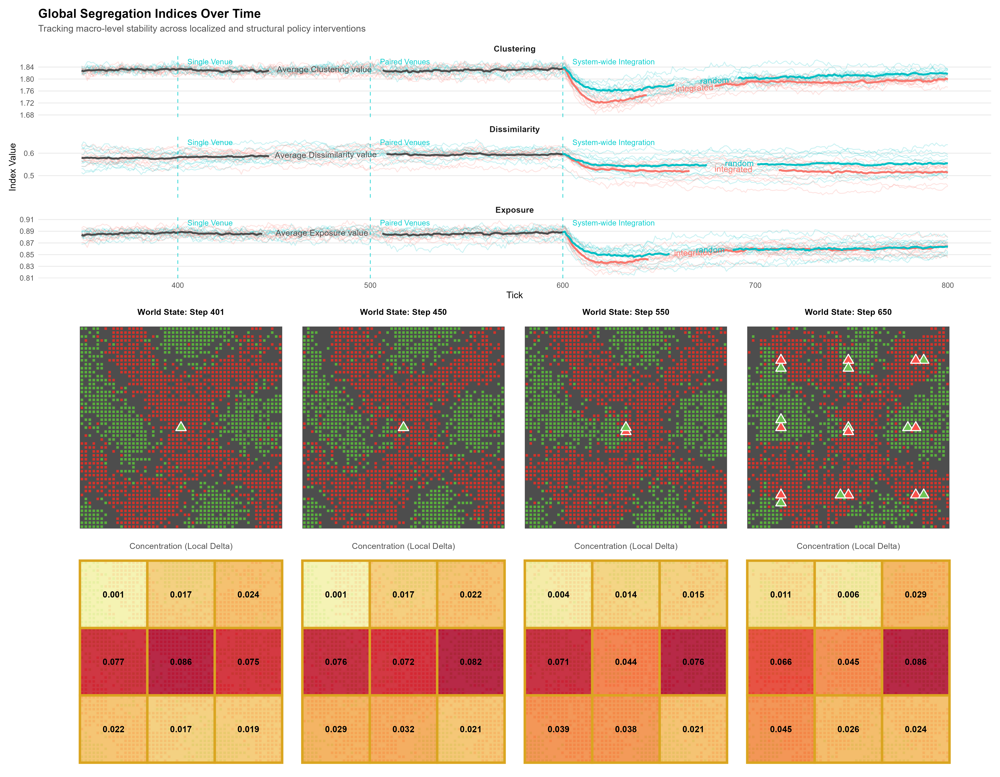

Joint work with [Benjamin Jarvis](https://liu.se/en/employee/benja42) at the [Institute for Analytical Sociology (IAS)](https://liu.se/en/research/computational-and-analytical-sociology), Linköping University, presented at the [CS2Nordics conference](https://nosocss.org/) (Nordic Conference on Computational Social Science) on September 21, 2026.

Venues as an important element of residential segregation.

## Slides

Below are the slides from the CS2Nordics presentation:

::: {.ratio .ratio-16x9 style="margin-top: 1.5rem; margin-bottom: 1.5rem;"}
<iframe src="https://docs.google.com/presentation/d/1LcFx77eBKyx7nR3h0flB_x9KIStEFvoIG8pIJg7Ib3s/embed?start=false&amp;loop=false&amp;delayms=3000" frameborder="0" width="100%" height="569" allowfullscreen="true" mozallowfullscreen="true" webkitallowfullscreen="true">

</iframe>
:::

[Google Slides](https://docs.google.com/presentation/d/1LcFx77eBKyx7nR3h0flB_x9KIStEFvoIG8pIJg7Ib3s/edit?usp=sharing){target="_blank"}

## In the model world:

- Local interventions change micro and meso level outcomes
- Macro level phenomenon are stable to local interventions ― reshuffling of segregation
- Systematic Interventions change micro, meso, and macro level outcomes

## In the real world:

- Local interventions change micro and meso level outcomes
- Local changes are crucial for the people who get affected, even if some KPI metrics are measured incorrectly How to communicate decisions and interventions to real policy makers and normal people?
