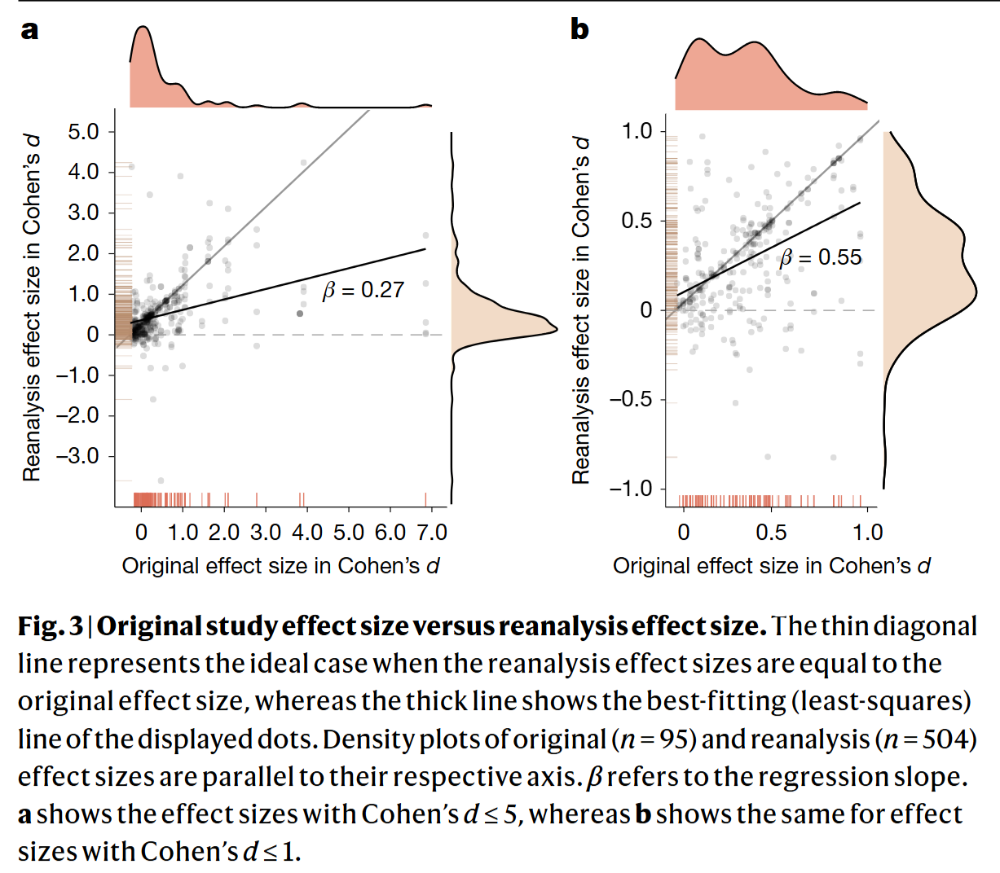

Fifty percent of social and behavioural science findings are not robust to a multi-analyst approach. Kind of.

This is also my first paper in *Nature*, where I am a co-author. Kind of.

> **Paper**: Aczél, B., Szaszi, B., Nosek, B. A., et al. (2026). *Investigating the analytical robustness of the social and behavioural sciences*. **Nature**.  
> [Read on Nature](https://doi.org/10.1038/s41586-025-09844-9){target="_blank"} | [Discussion on LinkedIn](https://www.linkedin.com/feed/update/urn:li:activity:7186358133346914304/){target="_blank"}

***

I joined late, so the project had already run out of money to pay for the analysis, and the sign-up spreadsheet had run out of slots. I only put myself down as *backup re-analyst 2* for a paper that was not particularly interesting.

After some time, I got an email saying that one of the main analysts had dropped out. Now I had a chance to look at a sentence from an abstract, load a CSV file, and try to get the same number on short notice.

The paper I was assigned made a claim about attitudes towards an out-group after a war, but they measured it with an amount of money in a variation of the dictator game. While the analysis was fine, the generalization seemed wild to me.

I ran some version of ANOVA, submitted the $p$-value, Cohen’s $d$, and degrees of freedom to a Google form, and forgot about the whole interaction.

Almost a year later, a new email arrived in my inbox: **Update Before Manuscript Submission**. 

The Multi100 team had drafted a *Nature* submission, and all I had to do was check my affiliation. Technically, I could have contributed to a spreadsheet with comments, but there were already over a thousand comments ranging from typos and punctuation marks to fundamental disagreements with the conceptual framing. I decided not to add to the core team's suffering.

A few months later, the draft was submitted to *Nature*, and a few months after that, it received extremely positive reviews. I don’t think I will ever see:

> *"[\...] It should be published. A few thoughts for the authors to consider: [\...]"*

regarding my own standalone work anytime soon.

I really like how Brian Nosek put it in the second-to-last email I will ever get from him (he also did not know I exist):

> *"Compared with the entire SCORE project, your role may feel small. However, SCORE grew so large only because each of us contributed our part."*

The collaborative process itself remains one of the most interesting parts of this project, along with how the Multi100 team tried to provide opportunities to contribute at almost every stage.

There are simply no good tools or established techniques for having 494 opinionated researchers write in the same document. It is not clear how to organize the codebase, and given the sheer volume, I am not entirely sure if dumping hundreds of gigabytes of supplemental materials actually makes a project open and accessible. I genuinely hope someone on the core team writes a paper analyzing the meta-process of running this collaboration itself.

### So, Are We In Trouble?

The main results are somewhat expected. Results from papers that were never written with reproduction in mind don’t always reproduce from a single sentence in an abstract. Paul E. Meehl and all of that.

However, in the grand scheme of things, it does not matter that much: **74% of re-analysts reached the same qualitative conclusion.**

Social and behavioural sciences are fine.
