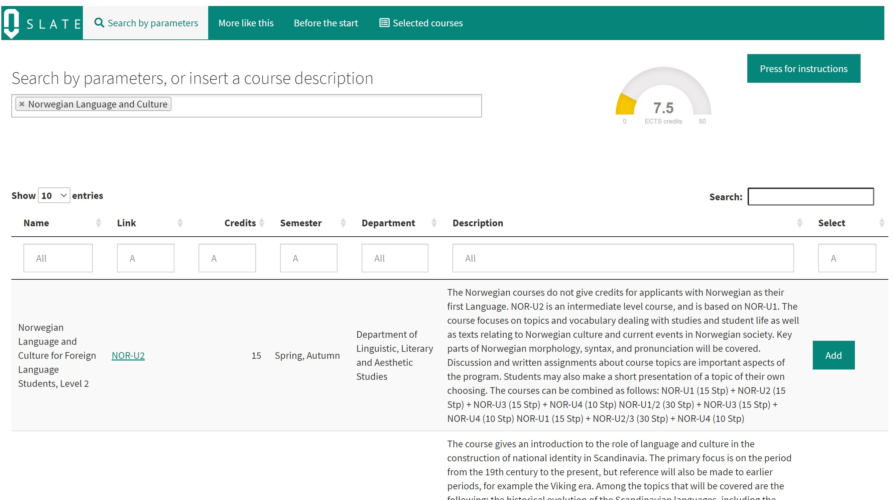
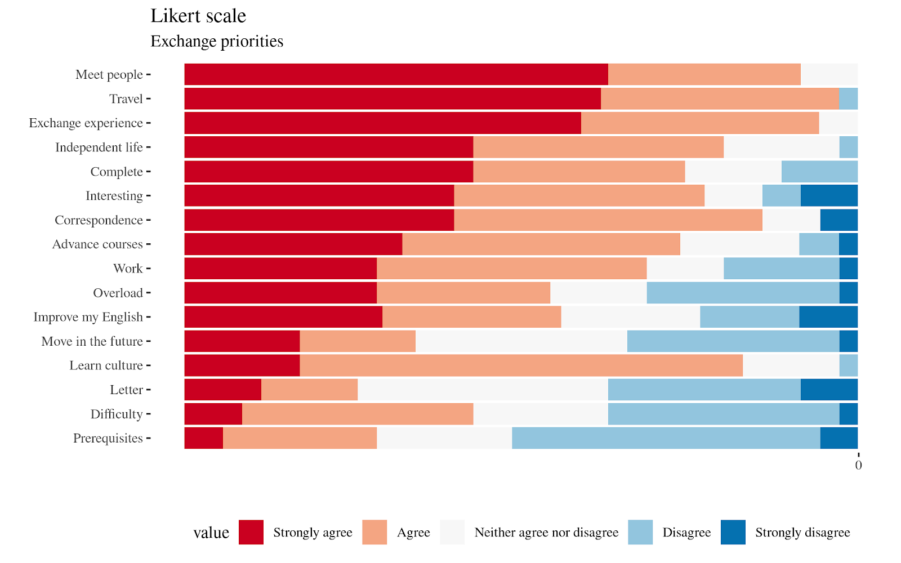

I was working as a Research Assistant at University of Bergen and created a course recommendation systems, using R Shiny that was integrated with Elasticsearch and doc2vec embedding model. [Poster](https://www.researchgate.net/publication/350874550_Creating_a_Course_Recommendation_System_for_Exchange_Students).

The interface included a small survey about motivations and priorities of exchange students, a small AB test of recommendation algorithms (tf-idf vs embeddings) and an actual course search system. We presented some initial results at International Conference on Learning Analytics & Knowledge (LAK21).

Some preliminary results from the survey about important factors for an exchange term.

[A full citation](https://www.researchgate.net/publication/350874550_Creating_a_Course_Recommendation_System_for_Exchange_Students):
Suschevskiy, V., & Khalil, M. (2020). Creating a course recommendation system for exchange students. Companion Proceedings of the Learning Analytics & Knowledge 2020, LAK’20.